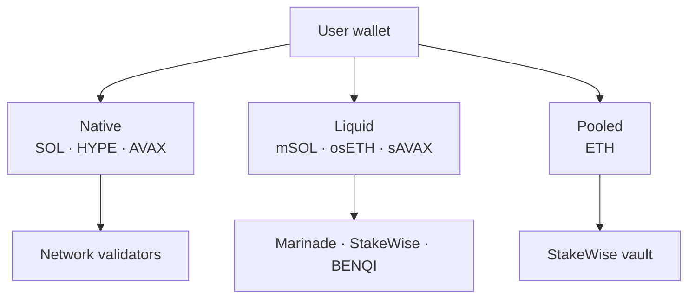

  <picture>
    <source media="(prefers-color-scheme: dark)" srcset="https://docs.dyxy.io/logo/dark.svg">
    
  </picture>

# DYXY Staking

How DYXY offers three kinds of staking in one place: native delegation, liquid staking tokens and pooled ETH staking.

> This repository describes how the product works. It does not contain DYXY source code. User guide: [docs.dyxy.io/earn/staking](https://docs.dyxy.io/earn/staking/overview).

## Three ways to stake

| | Native | Liquid | Pooled |
| --- | --- | --- | --- |
| Assets | SOL, HYPE, AVAX | SOL → mSOL, ETH → osETH, AVAX → sAVAX | ETH |
| User holds | A delegation | A reward-bearing token | A share of a vault |
| Liquidity | Lock or unstaking period | Tradable at any time | Exit queue |
| Rewards | Added to stake or paid at period end | Token value grows | Added to staked balance |
| Details | [docs/native.md](docs/native.md) | [docs/liquid.md](docs/liquid.md) | [docs/pooled.md](docs/pooled.md) |

## Fees

Native and liquid staking carry no DYXY fee. Pooled staking carries a DYXY service fee. Validators and staking protocols take their own commission, and the APY shown is after it. Network gas applies to each transaction.

## Rewards in the portfolio

Users may earn in several tokens at once, so total staking rewards are shown in USD in the [portfolio](https://github.com/dyxy-io/portfolio).

## License

Text and diagrams in this repository are licensed under [CC BY 4.0](LICENSE). The DYXY name and logo are not covered by this license.
