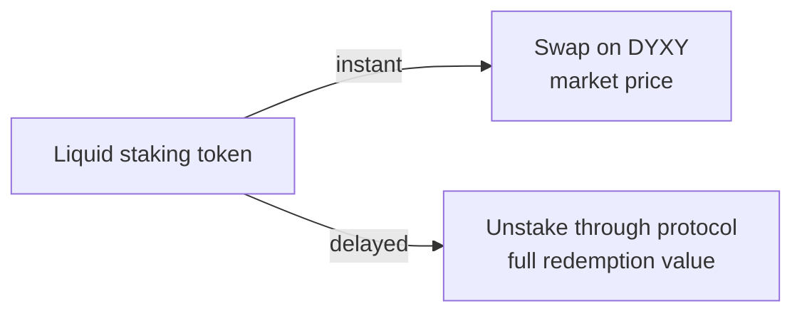

# Liquid staking

Liquid staking returns a token for staked assets. The token keeps earning and stays usable: it can be swapped, used as collateral or provided as liquidity.

| Token | Stake | Protocol | Network |
| --- | --- | --- | --- |
| mSOL | SOL | Marinade | Solana |
| osETH | ETH | StakeWise | Ethereum |
| sAVAX | AVAX | BENQI | Avalanche |

## Reward-bearing tokens

The number of tokens stays the same. Each token becomes worth more of the underlying asset as rewards accrue.

```
tokens received   = amount staked ÷ exchange rate
redemption value  = tokens × current exchange rate
```

**Example.** 10 SOL staked at 1 mSOL = 1.25 SOL gives 8 mSOL. At 1 mSOL = 1.34 SOL a year later, 8 mSOL is worth about 10.7 SOL.

## Exiting



| Token | Unstake through protocol |
| --- | --- |
| mSOL | Delayed unstake completes at the end of the Solana epoch, about 2 days |
| osETH | StakeWise exit queue, tied to Ethereum's validator exit queue, usually a few days |
| sAVAX | 15-day cooldown, then a 2-day window to claim. If missed, the AVAX must be restaked and the unstake requested again |

## Using the token

- Swap it on DYXY at any time
- Provide it in [pools](https://github.com/dyxy-io/pools)
- Supply it as collateral in [lend](https://github.com/dyxy-io/lend), where markets support it

Each use adds that protocol's risk on top of the staking protocol's.
