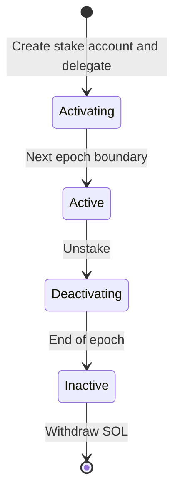
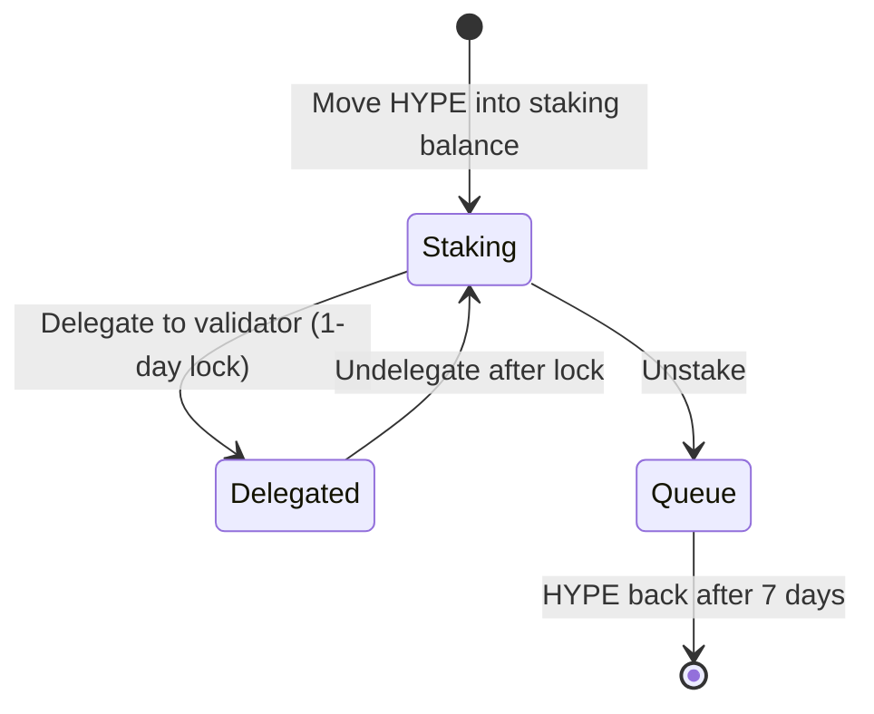
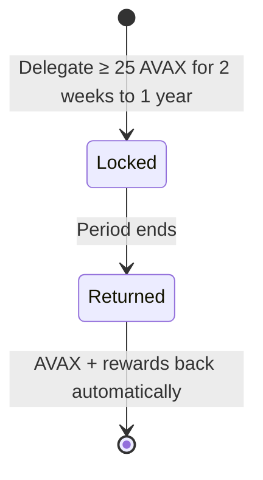

# Native staking

Tokens are delegated directly to validators on the network itself, with no extra contract layer. They can only be withdrawn back to the owner's wallet.

## Rules by network

| | SOL | HYPE | AVAX |
| --- | --- | --- | --- |
| Minimum | Enough for stake account rent | None | 25 AVAX |
| Lock | None after activation | 1 day per delegation | Chosen period, 2 weeks to 1 year |
| Activation | Next epoch, about 2 days | Immediate | Immediate |
| Unstaking | End of current epoch, about 2 days | 7-day unstaking queue | Automatic at period end |
| Rewards | Every epoch, added to stake | Accrue every minute, distributed daily, restaked | Paid at period end |
| Commission | Set by validator | Set by validator | Set by validator, at least 2% |

## Solana

## Hyperliquid

## Avalanche

AVAX delegations cannot be ended early. The period also cannot outlast the validator's own staking period.

## Choosing a validator

| Factor | Why |
| --- | --- |
| Commission | Lower leaves more reward |
| Uptime | Offline validators earn less |
| Concentration | Smaller validators help decentralization |
