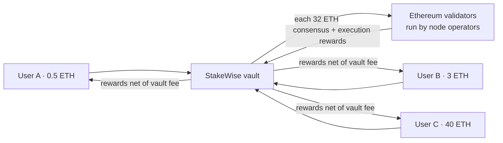
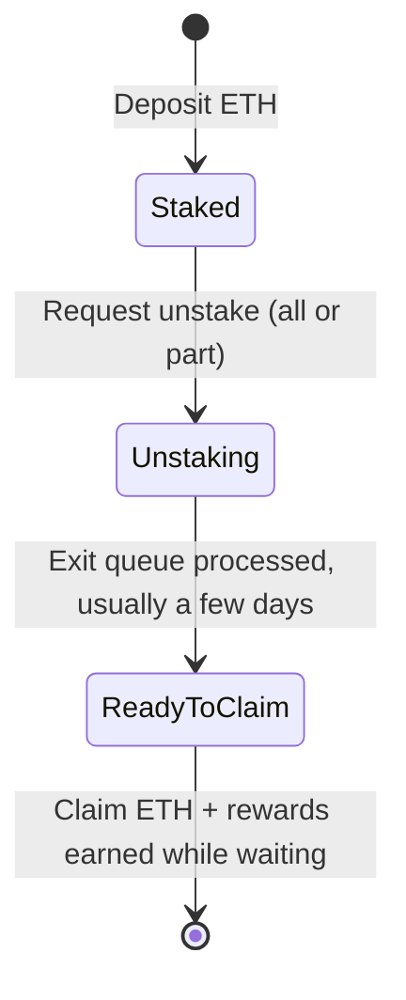

# Pooled staking

Running an Ethereum validator needs exactly 32 ETH and operating infrastructure. Pooled staking lets users stake any amount: deposits are pooled in a **StakeWise** vault, the same infrastructure behind MetaMask's pooled staking, and professional node operators run the validators.

## How it works

## Unstaking

ETH keeps earning rewards while it waits in the exit queue.

## Pooled or liquid

| | Pooled | Liquid (osETH) |
| --- | --- | --- |
| Holds | Staked balance in the vault | osETH tokens |
| Exit | Exit queue only | Exit queue, or sell instantly |
| DeFi use | No | Yes |
| Simplicity | Highest | Requires handling a token |

The vault takes a fee from rewards. The APY shown is after it. DYXY adds no fee.
